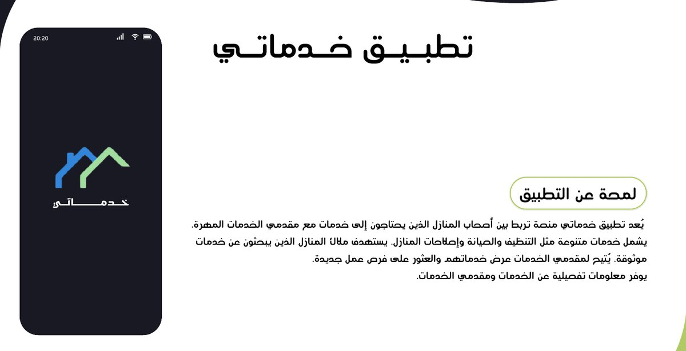
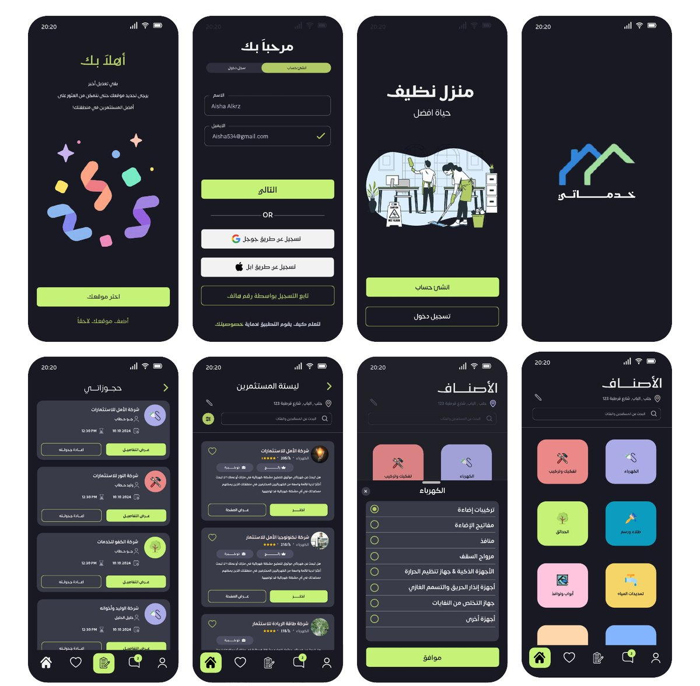

# Khadamati (خدماتي) · Home Services App UI/UX

A UI/UX case study for **Khadamati**, an Arabic mobile app that connects homeowners with trusted home service providers: cleaning, electrical work, plumbing, painting, gardening and more.

## The problem

Finding a reliable home service provider usually means asking around, with no way to compare prices, check reviews or know when someone will show up. Khadamati puts providers, prices and ratings in one place so people can book with confidence.

## Design process

The full case study, in Arabic, follows these steps:

1. **Survey:** questions about how often people need home services, what matters most when choosing a provider (quality, price, response time), and whether ratings and reviews would help them decide.
2. **User interviews:** open questions about current experiences, the biggest frustrations, and what's missing from existing options.
3. **Persona:** a 28-year-old graphic designer in Aleppo who wants to save time and needs fast, trustworthy help with home repairs.
4. **User flow:** from sign-up or log-in to the home screen, then browsing services, choosing a provider and confirming a booking, plus bookings, favorites, messages and the profile.
5. **Wireframes:** low-fidelity layouts for each screen in the flow.
6. **Final design:** high-fidelity screens in a dark theme with a lime accent and full right-to-left Arabic layout.

## Final screens

Splash, onboarding, sign-up with Google and Apple, location, service categories, service details, provider list with ratings and prices, and bookings.

## Files

- **`AppServiesHome.pdf`**: the full case study, from research to final design
- **`AppServiesHome.fig`**: the Figma source file. Import it into Figma to explore the screens and components

**Tools:** Figma
